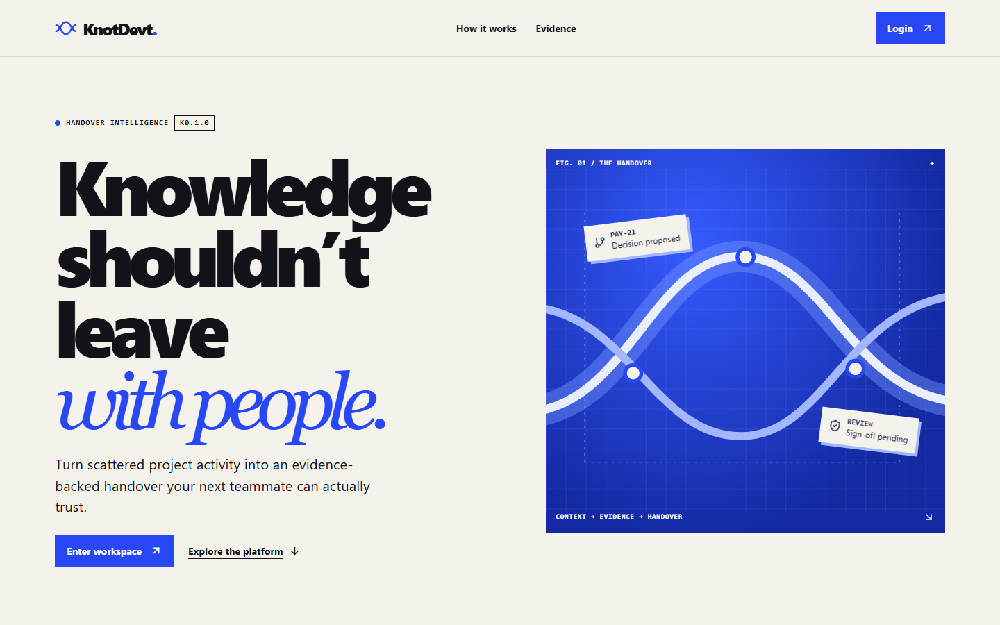
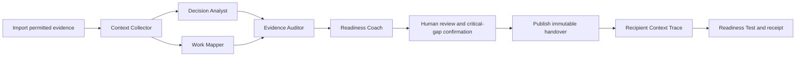
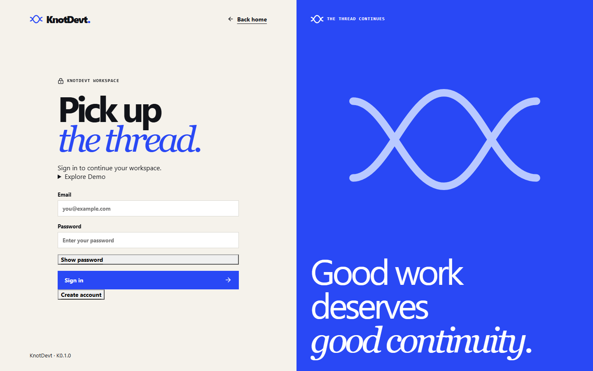

# KnotDevt

> Turn scattered project activity into an evidence-backed handover.

KnotDevt preserves the reasoning behind a project when responsibility moves to
someone new. It brings permitted issues, tasks, meeting notes, and conversation
records into one traceable thread, then turns that thread into a reviewable
handover. Team **SoloOne** built KnotDevt K0.1.0 for CodersInPune.



## The problem

When a teammate leaves, the work may still be documented, but the *why* is
usually scattered across tasks, meetings, conversations, and project records.
Decisions, unfinished work, ownership questions, blockers, and dependencies are
easy to lose between systems.

## The solution

KnotDevt collects authorized project evidence and produces a structured handover
with source-linked claims. AI proposes the threads; deterministic checks and a
human reviewer decide what can be published. Each approved handover keeps an
immutable version, a Context Trace, a critical-gap review, and a recipient
Readiness Test. A model suggestion is never treated as a verified fact merely
because a model stated it.

## Features

- Session authentication, role-based access, workspaces, and projects
- Private one-time teammate invitations and recipient assignment
- Guided issue/task and conversation-note imports, including supported JSON
- Five-agent LangGraph workflow with bounded Gemini or deterministic provider
- Evidence Explorer with source-linked claims and exact citation spans
- Reviewer claim correction and critical-gap validation
- Immutable handover versions and stale-version handling
- Recipient Context Trace, Readiness Test, and receipt acknowledgement
- PostgreSQL project scoping with Redis/Celery background jobs

Automatic Slack, Notion, Figma, Discord, PDF, and private GitHub ingestion are
not advertised. The public GitHub issue preview is read-only comparison; it is
not evidence import unless a supported source record is created.

## How it works



Decision Analyst and Work Mapper run in parallel. The workflow pauses at the
human checkpoint; a completed AI job is not an approved handover.

## Screenshots

These captures come from the local application. Authenticated project screens
are intentionally not published because they can contain evidence, account
identifiers, or private handover content.



## Technology

| Area | Implementation |
| --- | --- |
| Frontend | Next.js, React, TypeScript, GSAP, Lenis, React Flow, ELK.js |
| Backend | FastAPI, Pydantic, SQLAlchemy, Alembic |
| AI/orchestration | Persisted five-stage graph, Gemini adapter, deterministic test adapter |
| Data/jobs | PostgreSQL, Redis, Celery, PostgreSQL checkpoints |
| Security | HttpOnly sessions, CSRF, origin checks, RBAC, source policy checks |
| Testing | pytest, Ruff, mypy, TypeScript, ESLint, Next.js build, Playwright |

## Architecture

```text
Next.js UI -> FastAPI -> PostgreSQL
                  |         |
                  +-> Redis/Celery -> LangGraph stages -> Gemini (optional)
                  +-> Evidence, review, version, trace, readiness services
```

The frontend owns presentation and navigation. Authentication, permissions,
source visibility, workflow execution, evidence validation, review gates, and
readiness status remain authoritative in the backend.

## Getting started

### Prerequisites

Docker Desktop with Compose, Python 3.13, `uv`, Node.js, npm, and Windows
PowerShell (or equivalent shell).

### Backend and infrastructure

From the repository root:

```powershell
py -3.13 backend/scripts/init_local.py
docker compose up -d --wait
Set-Location backend
uv sync --locked
uv run alembic upgrade head
uv run python -m scripts.setup_runtime_db
uv run python -m scripts.setup_checkpoints
uv run uvicorn app.main:app --host 127.0.0.1 --port 8080 --no-access-log --no-proxy-headers
```

In two additional `backend` terminals, run:

```powershell
uv run celery -A app.workers.celery_app:celery worker --pool=solo --loglevel=INFO
```

```powershell
uv run celery -A app.workers.celery_app:celery beat --loglevel=INFO --schedule .venv/celerybeat-schedule
```

API: [http://localhost:8080](http://localhost:8080) · Swagger:
[http://localhost:8080/docs](http://localhost:8080/docs) · readiness:
`/health/ready`.

### Frontend

```powershell
Set-Location frontend
npm ci
npm run dev
```

Open [http://localhost:3000](http://localhost:3000). The frontend uses
`NEXT_PUBLIC_API_BASE_URL` when set and otherwise targets the local API.

## Environment variables

Copy [`.env.example`](.env.example) to the ignored root `.env` and fill local
values. Never commit `.env`.

| Variable | Purpose | Location |
| --- | --- | --- |
| `DATABASE_URL` | Alembic/owner database connection | Backend only |
| `RUNTIME_DATABASE_URL` | Restricted application connection | Backend only |
| `REDIS_URL` | Redis broker/cache | Backend and worker |
| `SESSION_SIGNING_SECRET` | Session signing | Backend only |
| `SECURE_COOKIES` | Secure-cookie mode for HTTPS | Backend only |
| `ALLOWED_ORIGINS` | Exact browser origins | Backend only |
| `LLM_PROVIDER` | `fake` for tests or `gemini` for live calls | Backend only |
| `LLM_MODEL` | Selected Gemini model | Backend only |
| `GEMINI_API_KEY` | Private Gemini credential | Backend only |
| `AGENT_ATTEMPTS`, `AGENT_TIMEOUT_SECONDS`, `AGENT_TOKEN_LIMIT` | Bounded execution | Backend only |
| `NEXT_PUBLIC_API_BASE_URL` | Optional frontend API origin | Frontend |

The committed example contains placeholders only.

## Using KnotDevt

1. Register or sign in.
2. Create a workspace and project.
3. Invite an existing teammate and assign the Recipient role.
4. Import permitted issue/task or conversation evidence.
5. Describe the handover task and select the intended recipient.
6. Run the five-agent workflow and wait for human review.
7. Inspect claims, citations, and the Evidence Explorer.
8. Correct unsupported claims where necessary.
9. Complete Critical-gap Review with evidence-backed dispositions.
10. Publish the immutable handover version.
11. The recipient opens Context Trace, completes Readiness Test, and acknowledges receipt.

Every step uses the backend. A successful model run does not publish a handover,
and a score of 100/100 cannot override unresolved project blockers.

## Example use case

An owner imports a task record, meeting note, and release conversation. KnotDevt
may surface a proposed decision, unfinished testing work, and an ownership
question. Each claim points to permitted source revisions. A reviewer corrects
wording, marks gaps as blocking or unverified, and publishes only after the
source snapshot and rubric are confirmed. The recipient rehearses the next task
against that exact approved version.

## AI safety and limitations

- AI output requires human review before publication.
- Missing evidence is not proof that an event never occurred.
- Exact quote matching does not by itself prove semantic support.
- Unknown ownership, approvals, and contacts remain explicitly uncertain.
- Closed issue state is not evidence that a fix was implemented.
- Critical blockers and lost source access fail closed.
- Public GitHub comparison is not automatic source ingestion.
- Unsupported third-party connectors are not advertised as available.

## Security

KnotDevt uses server-side HttpOnly sessions, CSRF and origin checks, role-based
workspace/project permissions, source-policy filtering, immutable source
revisions, reviewer approval, and immutable published handovers. Evidence and
graph nodes are filtered before they reach an unauthorized user.

## Testing

From `backend`:

```powershell
uv run ruff check .
uv run ruff format --check .
uv run mypy
uv run pytest -q
uv run alembic check
```

From `frontend`:

```powershell
npm run typecheck
npm run lint
npm run build
npm run test:browser
```

The browser smoke suite uses local Microsoft Edge by default. Full write
verification requires an explicitly supplied local demo password and isolated
local data.

## Project structure

```text
backend/app/agents/       provider, graph, citations, evidence logic
backend/app/api/          FastAPI routes
backend/app/services/     access, import, review, version, trace, readiness
backend/alembic/          database migrations
backend/tests/            unit, integration, security, load tests
frontend/app/             Next.js routes and global styles
frontend/src/             workspace, review, evidence, motion, API clients
frontend/tests/           browser and workflow checks
docs/                     API, architecture, database, testing, assets
```

## Current status

KnotDevt K0.1.0 is a local, judge-ready implementation of evidence-backed
handover review with a deterministic test adapter and optional Gemini provider.
Deployment, private repository connectors, and unsupported external ingestion
providers remain outside this release.

## Team

**SoloOne**

**KnotDevt — Keep the thread.**
