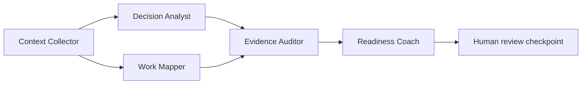

# KnotDevt backend architecture

FastAPI validates HTTP contracts and resolves the signed server-side session.
Application services own policy decisions and transactions. Repositories query
SQLAlchemy models backed by PostgreSQL. Pydantic defines API and agent schemas.
The API keeps original imports in private PostgreSQL storage and exposes only
authorized source revisions and excerpts.

An accepted import writes its raw bytes, job intent, and audit event in one
transaction. Celery Beat sends a dispatch tick through Redis every three
seconds. The dispatcher leases queued rows with `SKIP LOCKED` and sends job
IDs. The worker locks the job, uses a savepoint for its writes, and commits
the terminal state with its results. Repeated delivery sees the terminal
state and exits. If the broker loses a delivery, the database intent becomes
eligible for dispatch again. A failed write rolls back the savepoint.

Handover approval locks the project and draft, checks the expected revision
and current evidence for every audience member, and commits the exact
version, rubric, claim references, audit event, and graph resume job.
Subsequent claim corrections append revisions. Receipt and readiness have
independent records.

## Agent workflow

| Stage | Input and output | Tool access |
| --- | --- | --- |
| Context Collector | Task, bounded current revisions, explicit source IDs and reference matches | Authorized PostgreSQL retrieval and exact reference resolution |
| Decision Analyst | Context bundle to separate decision candidates, rationale gaps and relationships | Structured model output |
| Work Mapper | Context bundle to work, owners, contacts, blockers, prerequisites and recurring issue candidates | Structured model output |
| Evidence Auditor | Both branch outputs and the source bundle to span-checked claims and review flags | Local exact citation validation |
| Readiness Coach | Audited claims and context to four proposed rehearsal dimensions | Structured model output |

The collector selects at most 16 revisions visible to the requester and all
proposed recipients. LangGraph waits for both parallel branches before the
auditor runs. The auditor flags absent, ambiguous and contradictory
citations. Reviewers judge whether quoted evidence supports the claim's
meaning. The readiness coach proposes a rubric for human approval.

Each stage persists status, output, model, prompt version, attempt limit and
timeout budget. The Gemini adapter validates JSON Schema and then Pydantic.
Imported excerpts are untrusted data. Model calls receive a fixed system
instruction and have no tools for permission changes, publication, or
operational actions. The deterministic adapter exercises the synthetic demo.

LangGraph stores state in PostgreSQL and interrupts at the human review node.
The worker returns at that point. An approved database version queues a
separate task to resume the checkpoint. A repeated resume observes the
recorded verdict. Agent output remains visible only while the viewer can
access its entire source bundle.

## Access and consistency

Project access requires workspace membership and an explicit project
assignment. Source access then checks the live source policy. A restricted
source requires a grant even for an administrator. Published views withhold
derived content if any necessary source becomes inaccessible. Stale
assessment status is calculated against the live evidence, rubric lineage,
and critical prerequisite revisions. Reviewers can generate a fresh draft
from current evidence for manual recheck.
