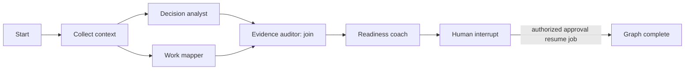
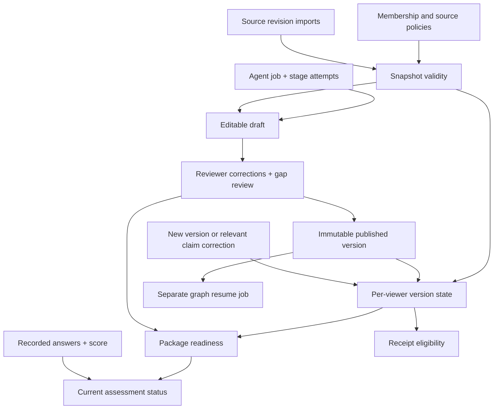

# Implicit state-machine audit

Audited 2026-11-13 against the current working tree, including uncommitted code.
This is static code analysis; no running services or databases were changed.

## Scope and counting

I identified **30 implicit machine families**, plus the already explicit LangGraph
workflow. A family can have multiple instances (every form submission, source,
version, recipient, etc.). Boolean display controls are listed separately so
they are not mistaken for business workflows. This is an inventory of the
application code, not a claim that every possible runtime interleaving was tested.

An implicit machine is behavior whose next action depends on prior state encoded
in booleans, nullable fields, row existence, counters, timestamps, URL parameters,
or combinations of those. The labels below describe conceptual states unless
formatted as exact contract values. Arrows describe implemented events, not an
assumed linear progression through every status.

## Backend machines

| # | Machine and state representation | Transitions and guards | Implementation |
| --- | --- | --- | --- |
| 1 | Account eligibility: absent / active / inactive (`User` existence and `active`) | Registration creates an account; inactive accounts cannot sign in or authenticate and lose effective project access. No account-deactivation endpoint was found. | [registration](../backend/app/api/auth.py#L31), [authentication](../backend/app/services/authentication.py#L61), [membership](../backend/app/repositories/identity.py#L15) |
| 2 | Session: absent / valid / expired / revoked | Sign-in creates an eight-hour session; time makes it expired; logout deletes it. Cookie integrity and active-account checks can deny an otherwise present session. Expired/revoked are inferred, not persisted enum values. | [authentication](../backend/app/services/authentication.py#L61) |
| 3 | Login/register throttle: no window / counting / throttled / dependency unavailable | Redis increments a per-client counter with a 60-second TTL; requests above 30 get 429; expiry resets eligibility; Redis failure returns 503. | [check_login_limit](../backend/app/services/authentication.py#L44) |
| 4 | Effective membership and permissions: absent / administrator / reviewer / contributor / recipient | Role assignment inserts or updates rows; project removal deletes a row. Effective access requires active user plus both workspace and project membership. Workspace admin and project role are separate dimensions, not one hierarchy of stages. | [role mutations](../backend/app/services/projects.py#L24), [effective membership](../backend/app/repositories/identity.py#L15), [guards](../backend/app/services/access.py#L26) |
| 5 | One-time invitation: absent / issued / expired / consumed / unusable | Issue creates a Redis record for one hour; redeem checks email, project and inviter's current admin rights, then atomically consumes the code and inserts missing memberships. Consumption precedes the database commit. Existing roles are preserved by conflict-do-nothing inserts. | [invitations](../backend/app/api/invitations.py#L48) |
| 6 | Import idempotency: unused key / bound to content / replay / conflicting reuse | First request binds `(project, actor, kind, key)` to an input hash; same key/hash returns the same job, even if it failed; different content gets 409. No key means no request-level replay protection. Source-content deduplication is separate. | [queue_import](../backend/app/services/imports.py#L32) |
| 7 | Source revision history: absent / current revision / historical revision / duplicate input | First import creates a source and revision; a new hash appends a higher ordinal; an existing hash reuses its old revision and marks the import result duplicate. Re-importing historical content does **not** promote it back to current. | [import_revisions](../backend/app/services/imports.py#L85), [current_revision_id](../backend/app/repositories/sources.py#L22) |
| 8 | Source policy and visibility: project / restricted-and-allowed / restricted-and-denied / deleted | Owner/editor policy changes replace allowlist and increment `policy_revision`; deletion sets `deleted_at` and increments that revision. Deleted sources cannot be read or reimported through these paths; there is no restore transition. Policy and content revisions are independent. | [manage_source](../backend/app/services/sources.py#L81), [visibility](../backend/app/repositories/sources.py#L10) |
| 9 | Durable job execution and dispatch: queued-and-due / deferred / executing / retry-wait / succeeded / failed | `state`, `attempts`, `dispatch_after`, broker dispatch, and transaction locks jointly encode execution. Dispatch defers redispatch by 15 seconds; worker increments attempts; transient failures retry below two job attempts; unexpected failures retry below three. Executing has no persisted/public running value. | [worker](../backend/app/workers/celery_app.py#L40), [Job](../backend/app/db/sources.py#L50) |
| 10 | Job presentation phase: `queued` / `waiting_retry` / `succeeded` / `failed` / `awaiting_human_review` | Derived from job kind, state and attempt count. Every queued job with nonzero attempts projects as waiting-retry; every succeeded agents job projects as awaiting-human-review. This does not inspect whether a draft/version already exists. | [job_view](../backend/app/services/jobs.py#L20) |
| 11 | Agent stage attempt and recovery: absent / `running` / `failed` / `succeeded`; stage-level retryable / exhausted | Each stage searches for reusable success, then allocates/reuses numbered attempt rows. Failed attempts are skipped, running attempts may be recomputed, and rows are updated to terminal status. There are inner stage retries and outer job cycles. Only the temporary-provider-unavailable final code requests the explicit transient job retry. | [run_stage](../backend/app/agents/graph.py#L82), [error classification](../backend/app/agents/graph.py#L56) |
| 12 | Agent evidence snapshot validity: readable-and-current / changed / inaccessible | Queuing binds immutable source IDs and policy revisions for actor and audience; execution, draft creation, corrections and publication revalidate according to `fresh`. Content/policy changes produce conflicts; lost visibility denies access. Read-only historical draft inspection uses `fresh=False`. | [queue_agents](../backend/app/services/agents.py#L57), [load_context](../backend/app/services/agents.py#L112), [draft_context](../backend/app/services/drafts.py#L37) |
| 13 | Claim review lifecycle: current revision / superseded revision with one of 11 claim statuses | Draft creation materializes audited claims; reviewer patch increments claim and draft revisions, validates exact evidence spans, and recalculates flags. There is **no status-transition matrix**: reviewers can replace one allowed status with another subject to evidence and snapshot guards. Automated auditing can downgrade unsupported statuses. | [patch_claim](../backend/app/services/drafts.py#L239), [claim contract](../backend/app/schemas/evidence.py#L26), [audit](../backend/app/agents/auditor.py#L76), [policy](../backend/app/agents/policy.py#L39) |
| 14 | Draft materialization and publication: absent / editable revision / publishable-or-rejected-by-guards / published snapshot(s) | Requires successful agents job and fresh evidence; one draft per job. Approval checks expected revision, recipient roles, supporting evidence, rubric and optional gap review, then creates an immutable numbered version and increments the draft revision. The draft is not marked terminal and can support later versions. Empty audit has repair/provenance fallback paths. | [create_draft](../backend/app/services/drafts.py#L146), [approve](../backend/app/services/versions.py#L28) |
| 15 | Critical-gap review validity and dispositions: missing / incomplete-or-invalid / validated for exact snapshot | Review must cover every current claim revision and the exact source set. Dispositions are `blocking`, `unverified`, `resolved`, `non_blocking`. Critical claims cannot become non-blocking without reclassification; resolution requires resolved status and no listed citation/contradiction problems. Stored review lives inside the published rubric, not an independently mutable review row. | [validate_gap_review](../backend/app/services/critical_gaps.py#L23), [stored_gap_review](../backend/app/services/critical_gaps.py#L70) |
| 16 | Handover version availability: `approved` / `stale` / `unavailable` / `withdrawn` | Computed per viewer. Precedence: withdrawal, missing readable sources, then staleness. Newer versions, changed source/policy snapshots, or relevant corrected claims make a version stale. Restored visibility can change unavailable to stale/approved; withdrawal has no undo path. | [version_state](../backend/app/services/versions.py#L162), [withdraw](../backend/app/services/versions.py#L249) |
| 17 | Package readiness: `ready` / `blocked_by_project_gap` / `access_review_required` / `stale_or_requires_review` | Derived on read. Version availability/freshness gates run first; blocking gaps then win; missing/unverified/incomplete gap review requires review; only the remainder is ready. Approved does not imply ready. | [package_readiness](../backend/app/services/readiness.py#L40) |
| 18 | Recipient attempt and effective readiness: absent / recorded score and original status / currently gated status | Submission creates a version-bound immutable assessment. Optional client key replays identical answers/explanation and conflicts on changed input. Ready package uses score/threshold; current package gates override displayed historical readiness. Stale versions can still accept attempts, but unavailable/withdrawn cannot. Original assessment is preserved. | [submit_attempt](../backend/app/services/readiness.py#L139), [recipient_status](../backend/app/services/readiness.py#L131), [assessment_view](../backend/app/services/readiness.py#L232) |
| 19 | Assessment review visibility: `pending` / `reviewed` / `withheld` | Review-row absence/presence controls pending/reviewed; authorized reviewer can insert or replace feedback. Unavailable/withdrawn viewer state withholds assessment details and review. A reviewer comment does not approve the package or override the score. | [assessment_view](../backend/app/services/readiness.py#L232), [review_attempt](../backend/app/services/readiness.py#L305) |
| 20 | Optional assessment advice: not requested / queued / succeeded / failed | Explanation on an approved version queues a job and advisory row; worker rechecks recipient assignment and version approval before writing feedback. Advice never changes score or readiness. It uses the shared durable-job machine but has distinct request/availability gates. | [queue_advice](../backend/app/services/readiness.py#L210), [run_advice](../backend/app/services/readiness_advice.py#L27) |
| 21 | Version receipt: absent / acknowledged / temporarily unreadable | Assigned recipient can create a receipt only for an approved version; repeated acknowledgement returns the original. Existing receipt remains readable/replayable when stale; unavailable/withdrawn blocks it. Receipt is independent of readiness and assessment completion. | [receipts](../backend/app/services/receipts.py#L21) |

## Frontend machines

These mirror server workflows but also have independent transitions and failure
states. The server remains authoritative.

| # | Machine and state representation | Transitions and guards | Implementation |
| --- | --- | --- | --- |
| 22 | Browser authentication: recovering / anonymous / authenticated / expired / logout-failed; login vs registration | `/auth/me` restores a session; login may register first and then sign in; success navigates to app; authenticated API 401 latches `expired=true`; logout navigates on success or shows an error. Registration succeeding and login failing leaves an existing account plus a form error. | [Workspace](../frontend/src/workspace.tsx#L40), [login](../frontend/app/login/page.tsx#L10), [API](../frontend/src/api.ts#L45) |
| 23 | Workspace navigation and selection: no workspace / workspace-selected / project-selected / permitted view / detail selection | URL parameters encode workspace, project, view, draft, version, rubric, attempt, job and claim. Available views depend on roles; invalid view falls back to overview; navigation usually clears detail IDs, selectively preserves them for evidence/readiness; workspace changes reset project selection and pagination. | [WorkspaceShell](../frontend/src/workspace.tsx#L65), [go](../frontend/src/workspace.tsx#L136) |
| 24 | Shared remote-resource lifecycle: disabled / loading / loaded / failed / obsolete-or-aborted | Empty path disables fetch. Path plus refresh counter is request identity; mismatched identity hides an old result; effect cleanup aborts requests. No built-in automatic retry. `Load` renders loading/error/value. This is instantiated throughout the app. | [useResource and Load](../frontend/src/data.tsx#L14) |
| 25 | Async mutation forms: idle / submitting / succeeded / failed, with form-specific substates | Encoded repeatedly as `busy`, `error`, optional result and navigation/refresh callbacks. Instances: workspace/project creation, invite redemption, invitation issue/copy, recipient assignment, import submission, agent submission, draft materialization, claim correction, publication, receipt acknowledgement, assessment submission. Invitation dialog also has closed / editing / code-issued / copied-or-manual-copy states. Native dialog state lives outside React. | [setup](../frontend/src/workspace.tsx#L178), [invite](../frontend/src/invite-teammate.tsx#L7), [project actions](../frontend/src/project-work.tsx#L56), [correction](../frontend/src/review.tsx#L580), [receipt](../frontend/src/recipient.tsx#L145) |
| 26 | Source import preparation and selection: no selection / selected source; task / meeting / message / file; no preview / reading / valid-preview / preview-error | Search resets pagination; choosing a source opens details; changing import mode clears preview; async file read checks element/file identity before updating; valid submission queues import and clears preview. File-reading is represented by absence of preview, not a distinct loading flag. Public GitHub comparison independently goes unchecked / checking / snapshot-or-error and never replaces imported evidence. | [Sources](../frontend/src/project-work.tsx#L56), [file preview](../frontend/src/project-work.tsx#L216), [public comparison](../frontend/src/project-work.tsx#L277) |
| 27 | Job observation: inactive / first fetch / polling / terminal / observation-error / disposed | Polls every two seconds while queued (also checks running/pending though backend does not emit them). Optional stage fetch follows job fetch. Terminal state stops polling; **any request error also stops polling**. Cleanup aborts and clears timer. Import success triggers source refresh. | [useJob](../frontend/src/project-work.tsx#L314), [ImportStatus](../frontend/src/project-work.tsx#L352) |
| 28 | Human review editor and publish confirmation: incomplete / complete / confirmed / dialog-open / publishing / error / published | `decisions`, `gaps`, derived completeness, `confirmed`, correction selection, native dialog and mutation flags encode this flow. Draft revision key remounts editor after correction, clearing local review decisions. Confirmation checkbox can remain checked as local decisions/gaps are edited; completeness is recalculated, but confirmation is not cleared on those edits. Server validates submitted snapshot at publication. | [Drafts remount](../frontend/src/review.tsx#L93), [DraftReview](../frontend/src/review.tsx#L141), [confirmation](../frontend/src/review.tsx#L510) |
| 29 | Readiness questionnaire: answering / reviewing / submitting / failed / assessment-open | All questions answered enables review; second submit posts; edit returns to answering. `attempt.current` survives request retries for idempotency and resets on answer changes. Reviewer can inspect but only recipient gets submit controls. Package status is displayed separately from answer completeness. | [Questionnaire](../frontend/src/recipient.tsx#L316) |
| 30 | Evidence workbench: closed/open; draft/version context; tree/trace/outline; loading/layout-ready/layout-failed; focused node; branches/filter; responsive orientation | Opening mounts native dialog; close unmounts via parent; detail context constrains allowed tabs; mode changes reset pagination. ELK layout uses an identity key and ignores obsolete completions. Selection hidden by filtering falls back to root. Reset clears filter/selection and expands branches. Responsive media subscription changes horizontal/vertical layout. | [dialog/detail](../frontend/src/evidence.tsx#L240), [graph](../frontend/src/evidence-graph.tsx#L62), [parent](../frontend/src/workspace.tsx#L78) |

## Already explicit workflow

The five-stage agent graph is already a real `StateGraph`, rather than an
implicit FSM. Its job status, approval persistence and stage retries remain
separate implicit machines described above.

Authority: [run_graph](../backend/app/agents/graph.py#L159),
[resume_review](../backend/app/services/review_resume.py#L12).
Approval creates the version before the separate resume job finishes; resume
failure does not automatically withdraw the version. Although the graph accepts
a boolean verdict, the application path found here resumes with `True`; no
product rejection/resume-with-false flow was found.

## Small presentation machines

These are real local states but grouped outside the 30 workflow families:

- Public route transition: idle → covering → navigating/waiting → uncovering →
  idle. `active`, GSAP timeline, `finish.current`, pathname effects and a
  2.5-second fallback timeout encode it. Reduced-motion preference bypasses
  interception. [PublicMotion](../frontend/src/public-motion.tsx#L8).
- First-visit introduction: unseen → animating → seen in `sessionStorage`;
  skips for reduced motion or unavailable storage. Same file, intro effect.
- Light/dark theme, expanded/collapsed sidebar, announcement visible/dismissed:
  [WorkspaceShell](../frontend/src/workspace.tsx#L65).
- Password hidden/visible and login/register mode:
  [Login](../frontend/app/login/page.tsx#L10).
- Landing-page selected example, disposition and active stage, plus GSAP
  animation lifecycle: [Landing](../frontend/src/landing.tsx#L94).
- Pagination, search/filter text, citation editor enabled/disabled, mobile claim
  navigator, and native `
` disclosure controls across the UI. These
  are selection/disclosure state, not durable business lifecycles.
- Dependency health ready/unavailable is recomputed from PostgreSQL and Redis
  probes, not a persisted operational lifecycle:
  [health](../backend/app/api/health.py#L24).

## Coupling that matters

## Important mismatches and modeling risks

1. **Job phase never leaves human review after publication.** `job_view` maps
   every succeeded agents job to `awaiting_human_review`, without consulting
   draft/version or checkpoint state. Treat it as execution outcome, not full
   handover lifecycle. [jobs.py:20](../backend/app/services/jobs.py#L20).
2. **Attempt rows are mutable, not append-only events.** Existing
   [state-machine map](state-machines.md) calls stage attempts append-only, but
   `running` rows are updated to `failed`/`succeeded`. Numbered attempt history
   exists; a complete transition event log does not.
   [graph.py:114](../backend/app/agents/graph.py#L114).
3. **Queued versus retrying versus running is a lossy projection.** Attempts
   and scheduling infer retry state; no public executing phase exists. A job
   with previous attempts will still read as waiting-retry during subsequent
   work. [worker](../backend/app/workers/celery_app.py#L61),
   [projection](../backend/app/services/jobs.py#L20).
4. **A polling transport error becomes a terminal observer state.** Backend
   work may keep progressing while UI stops refreshing. A stage-fetch error
   also replaces the whole observed result with an error.
   [project-work.tsx:320](../frontend/src/project-work.tsx#L320).
5. **Critical-gap confirmation is partly browser-local and optional in API
   approval.** Review decisions are not independently autosaved. The approval
   service validates review only when supplied. A version can therefore be
   published without it, but package readiness fails closed afterward.
   [approve](../backend/app/services/versions.py#L78),
   [package_readiness](../backend/app/services/readiness.py#L54).
6. **Publication and graph completion are separate commits/jobs.** The version
   is available before asynchronous graph resume is known to succeed. Model
   these as separate outcomes rather than one atomic transition.
   [approve](../backend/app/services/versions.py#L107),
   [resume_review](../backend/app/services/review_resume.py#L12).
7. **Invitation consumption and membership creation span two stores.** A
   database failure after Redis `getdel` can consume the code without creating
   membership. This is a failure window visible by code inspection, not a
   reproduced incident. [redeem](../backend/app/api/invitations.py#L66).
8. **Claim status is an editable vocabulary, not a constrained lifecycle.**
   Do not infer a required sequence such as proposed → accepted → implemented,
   or assume rejected is terminal. Evidence validation and publication/readiness
   gates supply the actual restrictions.
   [patch_claim](../backend/app/services/drafts.py#L239).

If formalizing these flows, start with the job/observer pair, draft publication,
version freshness and package readiness. Keep score, review, receipt, and
availability as separate dimensions; one combined status would lose existing
behavior. Consolidating repeated browser mutation state is a smaller follow-up.

## Verification boundary

Reviewed frontend state hooks, effects, URL navigation and action handlers;
backend services, route guards, schemas, models, repository visibility rules,
worker scheduling and graph/checkpoint orchestration. Compared against the
existing state-machine map. Stateless provider selection, citation normalization,
public research helpers and health checks were not counted as additional durable
workflows merely because they branch. No application code was changed and no
runtime concurrency/failure scenarios were executed for this inventory.
